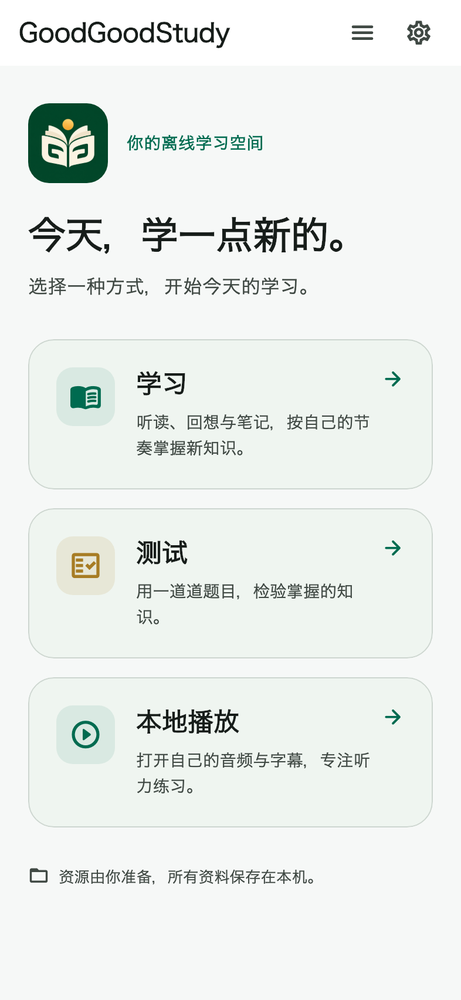
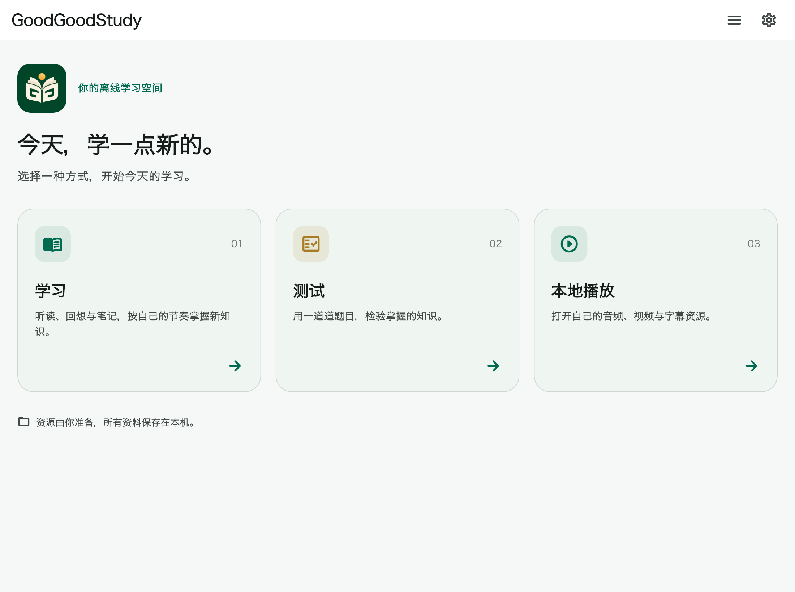

# GoodGoodStudy


当前版本：**0.8.1+29**。

当前暂定图标为 D4-3：浅桃粉背景、薄荷与白色层叠书页、桃色书签。

GoodGoodStudy 是一个使用本地资料的学习工具，提供 **学习、测试、本地播放** 三个平级入口。首次打开显示首页；之后恢复上一次使用的模块，也可通过页面展开菜单切换。学习与本地播放页左上角提供返回首页的快捷箭头，返回前暂停播放并保存进度。界面支持中文、日本語和 English，主题支持浅色、深色及跟随系统。

本仓库和发行资源不包含教材、题库、录音、视频、用户笔记或个人进度。使用者需自行准备有权使用的学习包、测验包和本地媒体。应用不会自动下载或转换教材，也不提供教材下载服务。

## 功能

- 学习：导入学习 ZIP，显示准备好的假名和词条说明，支持笔记、关键词／全文遮蔽及学习位置保存。
- 测试：导入独立的单选题 ZIP，按设定题数与时间作答，保存未完成试卷、成绩和错题统计。
- 本地播放：macOS 支持本地音视频和字幕；iOS 使用 Apple AVPlayer 播放本地音频及字幕。
- 页面恢复只恢复位置和模块，不自动播放音频或自动开始新的考试。
- 可选 iCloud 同步：在设置中开启后，同步已导入的学习包、题库、包内音频及学习笔记与进度；各设备保留本地副本，下载内容在完整校验后导入。冲突保留双方，可在同步设置中选择处理。

资料默认保存在使用者自己的设备。iCloud 同步默认关闭，开启后由 Apple 将所选范围传输到同一 Apple Account 下的其他设备。未完成的测试、独立播放器文件、语言、主题与页面偏好保留在各设备。不同资料包使用稳定 ID 与递增修订号更新。

iCloud 需要两端配置同一个共享容器并使用获得 iCloud 权限的签名。旧 wildcard iPhone profile 和 ad-hoc Mac 包不具备此权限；设置页会明确显示不可用原因。配置与范围见 [iCloud 同步说明](docs/icloud-sync.md)。

格式说明：[学习包](docs/study-package-v1.md)、[测验包](docs/quiz-package-v1.md)。文档中的短句与题目是为解释格式编写的合成示例，不是随应用发行的教材。

## 界面预览

以下为早期页面结构预览，实际文案与图标以当前版本为准。




## English / 日本語

**English:** A local-first study tool with Study, Quiz, and Local Media. Optional iCloud Documents sync is off by default and requires authorized signing and a shared container. When enabled, it syncs imported study/quiz packages, included audio, study notes and progress across your devices. Bring your own lawfully obtained materials; no textbooks, question banks, recordings or personal records are bundled.

**日本語:** 「学習」「テスト」「ローカル再生」を選べるローカル優先の学習ツールです。iCloud 同期は初期状態ではオフで、共有コンテナと適切な署名が必要です。有効にすると学習・テスト資料、付属音声、学習ノートと進捗を自分の端末間で同期します。教材・問題集・音声は同梱していません。利用権のある資料を各自で用意してください。

## 开发与构建 / Build

iOS/macOS 构建需要 macOS、Xcode 和对应平台 SDK，以及 Python 3.10+；使用 CocoaPods 的插件还需要 CocoaPods。

验证使用的工具链是 **Flutter 3.47.7 / Dart 3.13.5**。SDK 和依赖缓存不随仓库提供。请将 Flutter 加入 PATH，或将 `FLUTTER_ROOT` 指向自己的 SDK 目录。脚本不依赖仓库的父目录或特定用户名。

```sh
./flutterw --version
./flutterw pub get
```

为修复 Flutter 3.47.7 的特定 macOS 无障碍问题，仓库保留了审查过的 Flutter PR 193372 backport。脚本不会自动修改 SDK。使用该版本的开发者可以明确选择检查或应用补丁：

```sh
./flutterw --check-sdk-patch
./flutterw --apply-sdk-patch
```

补丁脚本校验 SDK 修订和前后哈希，拒绝改写不匹配的 SDK。来源和 BSD 许可见 [第三方说明](THIRD_PARTY_NOTICES.md)。`build` 与 `run` 默认检查补丁状态；已自行验证其他 SDK 的开发者可通过 `GOODGOODSTUDY_SKIP_SDK_PATCH_CHECK=1` 跳过该检查。

```sh
./flutterw analyze
./flutterw test
python3 -m unittest discover -s tool -p 'test_*.py'
./flutterw build macos --release
./flutterw build ios --release --no-codesign
```

iOS 真机签名请用 Xcode 打开 `ios/Runner.xcworkspace`，选择自己的开发团队。公开源码没有个人开发团队、证书或描述文件。现有 bundle identifier 为源码兼容而保留；独立发行时应配置自己管理的 ID 和签名。

依赖获取和首次构建可能需要网络。macOS 原生播放库含 Dart 包以外的组件，公开分发二进制前应按实际构成核对其许可证和源码提供义务。

## 测试与公开范围

常规模型、存储和界面测试使用合成数据与临时目录。依赖非公开教材的旧验证、个人端末诊断、过往签名安装包以及显示教材的截图不包含在公开仓库。可选外部字幕验证没有显式环境变量时会跳过。

`tool/offline_guard.py` 检查依赖、权限和应用源码。请先解析依赖并生成原生项目文件。基线变更需要人工核对，静态检查不代表已经穷尽运行时通信行为。

发布源码前的文件、个人路径与秘密信息模式检查：

```sh
python3 tool/audit_public_export.py
```

## 许可证与来源

本项目以 **GNU Affero General Public License v3** 发布。请阅读 [LICENSE](LICENSE) 和 [来源归属](docs/upstream-provenance.md)。Enjoy Player 本地播放与字幕逻辑的上游归属继续保留。软件的开源许可不授予第三方教材、题库或音频的再分发权。

Flutter、Dart 包及原生播放组件分别适用其许可证。来源与随附许可原文见 [THIRD_PARTY_NOTICES.md](THIRD_PARTY_NOTICES.md)。
